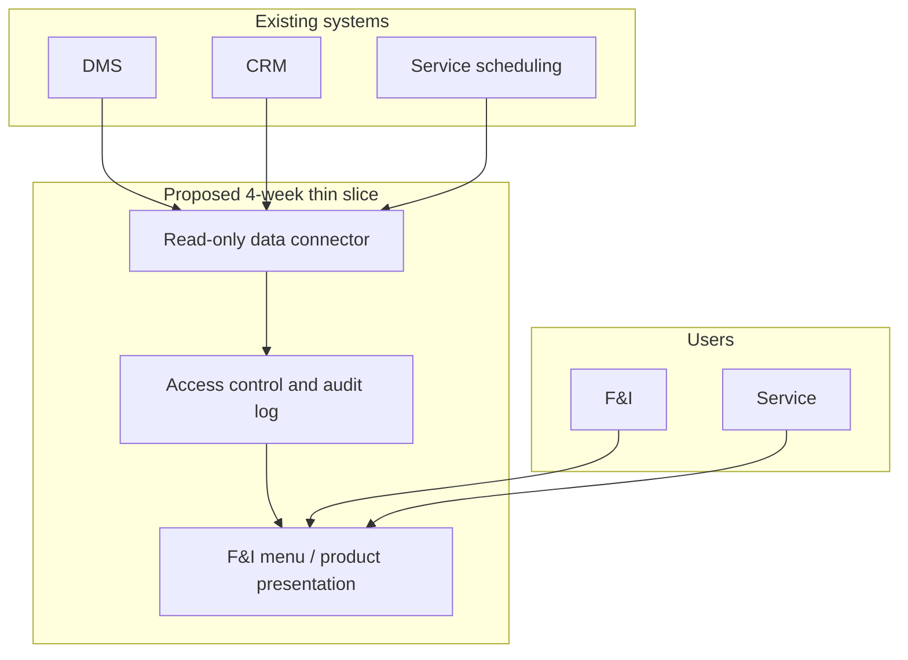

# 4-Week Statement of Work: AI Scoping Engagement — Lakeside Auto Group (sample)

**Generated:** 2026-11-24  
**Industry:** Automotive retail / dealer group  
**Data sensitivity:** Regulated  
**Size / footprint:** 40-rooftop group; multi-site / complex rollout  
**Existing systems:** DMS, CRM, Service scheduling  
**Team context:** Large enterprise IT (central) plus store-level managers

> This document was generated by the Automated Architecture Scoper, a portfolio demo. It is a starting point for a human-led discovery conversation — not a production architecture, a security assessment, or a legally binding statement of work. Every section should be reviewed with the customer before it is used in a real engagement.

## 1. Problem summary

Lakeside Auto Group (sample) is an automotive retail group (40-rooftop group; multi-site / complex rollout) asking for AI help in F&I and Service. The stated need is to improve F&I menu / product presentation, Service write-up quality, and Appointment no-show reduction. Today those workflows sit on DMS, CRM, and Service scheduling, and they touch Payment / consumer credit data and PII (personally identifiable information). That puts this work in a Regulated data class: deal jackets and consumer credit information cannot be treated like a casual chatbot project.

The business problem underneath the 'we want AI' ask is consistency and time. F&I product presentation and service write-ups vary by store and by manager. A four-week scoping engagement will map the current path from desk to DMS, pick one thin slice that can show value without writing back into production, and leave the group with a plan they can take to IT, compliance, and store leadership. This is a scoping and proof-of-value engagement, not a 40-rooftop rollout.

### Original customer ask

> We're a 40-rooftop auto dealer group and want AI for our F&I and service departments. F&I managers spend too long building menus, product penetration is inconsistent across stores, and service advisors struggle with no-shows and write-up quality. We run a common DMS and a CRM today, and we care a lot about customer credit data and deal-jacket privacy.

## 2. Assumptions

- A named business owner and a technical counterpart will be available for workshops in each of the four weeks.
- The engagement can start with read-only access or a safely extracted, minimized dataset from DMS, CRM, and Service scheduling — not live write access.
- The first pilot will be limited to a small number of users and sites rather than all of 40 sites at once.
- Success metrics listed in this SOW are proposed starting points; baselines will be confirmed with the customer in week 1.
- This plan assumes English-language workflows and a US regulatory context unless discovery says otherwise.
- F&I menu / product data and a representative set of service write-up examples can be provided (live, extracted, or synthetic).
- Store-level process variation is expected; the prototype will target a shared pattern, not every rooftop's custom workflow.

## 3. Scope

### In scope

- Discovery with F&I and Service stakeholders and a current-state map of how work flows through DMS, CRM, and Service scheduling.
- A proposed target architecture for F&I menu / product presentation, Service write-up quality, and Appointment no-show reduction, including integration style (read-only first) and data-minimization choices.
- A simple STRIDE-style threat model focused on deal-jacket, consumer-credit, and customer PII exposure.
- A thin-slice prototype or clickable workflow on sample or minimized data that illustrates F&I menu / product presentation, Service write-up quality, and Appointment no-show reduction.
- A pilot recommendation for a small subset of rooftops, with staffing, KPIs, and a go/no-go checklist.

### Out of scope

- A full production rollout across every site or department.
- Replacing or re-platforming core systems of record.
- Training a foundation model from scratch, or fine-tuning on the customer's full historical data warehouse.
- 24/7 production support, an SLA, or a multi-year transformation program.
- A formal legal review, penetration test, or certified compliance audit (the threat model here is a starting discussion, not an assessment).
- Any write-back that changes production records in week 1–3; write-back, if considered at all, is a week-4 recommendation only.
- Changing how lenders, product providers, or the DMS itself calculates terms or rates.
- A group-wide F&I playbook rewrite or a full service-lane staffing redesign.

## 4. Four-week plan

### Week 1: Discovery and current-state mapping

**Goals**

- Turn the vague 'we want AI' ask into one or two measurable workflows in F&I and Service.
- Inventory DMS, CRM, and Service scheduling and the data that would actually have to move.

**Activities**

- Kickoff with the group operator / GM sponsor, F&I director, and service director.
- Sit with two or three F&I managers and service advisors (not just leadership) and watch a live deal or RO write-up.
- Document systems, reports, and shadow tools (spreadsheets, shared drives, lender portals).
- Confirm what 'good' looks like: PVR / product penetration, time in the F&I office, write-up completeness, no-show rate.
- Agree the thin-slice candidate and the data we are allowed to touch.

**Deliverables**

- Current-state workflow map for F&I and Service.
- System and data inventory (what exists, who owns it, what is sensitive).
- Confirmed week-3 prototype scope and a short list of explicit non-goals.

### Week 2: Architecture, data handling, and threat model

**Goals**

- Propose a target architecture that can sit beside DMS, CRM, and Service scheduling without replacing them.
- Write down how credit data, deal jackets, and customer PII will be handled — and what will be kept out of the prototype.

**Activities**

- Draft the architecture: users, existing systems, a read-only connector, access control, audit log, assistant.
- Define data minimization (no full SSN or raw credit reports in the prototype; tokenize or redact where possible).
- Walk a STRIDE-style threat model with IT / the DMS owner and, if available, a compliance contact.
- Choose integration mechanics: file extract vs. API vs. read replica; prefer the path that can be stood up in days, not months.

**Deliverables**

- Target architecture diagram and a one-page narrative.
- Data-handling note (sources, retention, access, redaction).
- STRIDE threat model table with agreed mitigations for the four-week slice.

### Week 3: Thin-slice prototype

**Goals**

- Show one working slice of F&I menu / product presentation, Service write-up quality, and Appointment no-show reduction that a real F&I manager or service advisor can react to.
- Prove the architecture path (ingest → govern → assist) on sample or minimized data.

**Activities**

- Build a narrowly scoped assistant: for example, a menu-building / product-talk track helper for F&I, or a write-up completeness helper for service — not both unless week 1 said the data is already clean.
- Load only the agreed sample or redacted extract.
- Review with 3–5 end users. Capture what they would trust, what they would ignore, and what would slow them down.
- Log defects and scope questions in a parking lot; do not widen the slice.

**Deliverables**

- Working prototype (demo-quality) and a short demo script for store leaders.
- User feedback notes and a list of must-fix items before any pilot.
- Updated architecture if the prototype taught us something week 2 missed.

### Week 4: Pilot plan, metrics, and handoff

**Goals**

- Leave the group with a plan they can say yes or no to — not a slide that says 'phase 2 TBD'.
- Recommend a pilot on a small number of rooftops, not 40 sites all at once.

**Activities**

- Draft the pilot design: sites, users, duration (typically 4–6 weeks after this engagement), support model, and rollback.
- Lock KPIs and how baselines will be pulled from DMS, CRM, and Service scheduling.
- Write residual risks, compliance follow-ups, and a go/no-go checklist.
- Handoff readout with sponsor, IT, and department leaders.

**Deliverables**

- Pilot SOW addendum: staffing, timeline, KPIs, training, and support.
- Go/no-go checklist and residual risk register.
- Final architecture, threat model, and demo recording or live readout.

## 5. Proposed architecture

The proposed slice does not replace DMS, CRM, and Service scheduling. It sits beside them. A read-only connector pulls a minimized extract — never a live write into the DMS during this engagement. Access control and an audit log sit in front of the assistant so we can see who asked what, and so credit and deal-jacket fields can be redacted or excluded. F&I and Service users work in a narrow assistant scoped to F&I menu / product presentation, Service write-up quality, and Appointment no-show reduction. Data class is Regulated; relevant controls include Internal access control, Audit logging, GLBA (consumer financial information), PCI-DSS if card data is in scope, and State privacy laws (e.g. applicable US state privacy acts). If a later pilot needs write-back (for example, drafting a note on a repair order), that is a separate, explicitly approved path — not part of weeks 1–3.

The diagram below is a Mermaid flowchart. GitHub, many Markdown previewers, and this app will render it. If your viewer does not, the text is still readable as a source list of systems and flows.

## 6. STRIDE-style threat model

This is a discussion starter for week 2, not a penetration test or a formal security assessment. STRIDE groups threats into Spoofing, Tampering, Repudiation, Information disclosure, Denial of service, and Elevation of privilege.

| STRIDE | Threat | Mitigation in this slice | Priority |
| --- | --- | --- | --- |
| Spoofing | A staff member or vendor uses someone else's DMS or CRM login to query deals or customer credit data through the assistant. | SSO or named accounts, no shared store logins, session timeout, and the assistant inherits the user's existing role — it does not become a back door. | High |
| Tampering | Prompt input or a compromised connector is used to alter deal terms, product menus, or RO text if write-back is ever enabled. | Read-only in this engagement. Any future write-back would be drafted as a suggestion, require a human confirm, and be logged. | High |
| Repudiation | A manager disputes what the assistant recommended on a deal or a service write-up, and there is no record of the interaction. | Audit log of prompts, retrieved sources, and outputs, retained for an agreed period, with store and central IT access. | Medium |
| Information disclosure | Deal jackets, consumer credit data, or customer PII leak into logs, a model provider, or another store's context. | Data minimization and redaction; no raw SSNs or full credit reports in the prototype; store-level access boundaries; no training on customer data by default; prefer local or contractual endpoints. | High |
| Denial of service | The assistant or its connector is unavailable during peak Saturday traffic, and staff have no fallback. | The assistant is an aid, not a gate. Store process still works in the DMS alone. Rate-limit the prototype and document a fallback. | Medium |
| Elevation of privilege | A service advisor or a less-privileged role uses the assistant to see F&I deal terms or credit data they cannot see in the DMS today. | Role-aware retrieval. The assistant only surfaces fields the user's existing DMS/CRM role already permits. | High |

### Compliance and control notes

- Internal access control
- Audit logging
- GLBA (consumer financial information)
- PCI-DSS if card data is in scope
- State privacy laws (e.g. applicable US state privacy acts)

_User-selected sensitivity: Regulated. Detected signals: consumer credit / payment data, personally identifiable information._

## 7. Success metrics and KPIs

Baselines and targets are proposals. Week 1 confirms the real numbers, or honestly records that a baseline does not yet exist.

| Metric | Baseline | Target | How it will be measured |
| --- | --- | --- | --- |
| Time in the F&I office (selected product presentation steps) | Confirm in week 1 from a sample of deals (often 45–90 minutes door-to-door; we will measure the specific steps the slice touches). | A realistic pilot target is a 15–25% reduction on the steps in scope, without a drop in compliance completeness. | Timestamps from the DMS / F&I log plus a short observer sample at pilot stores. |
| F&I product penetration / PVR consistency across pilot stores | Current penetration and PVR, and the spread between stores, pulled from existing F&I reports. | Narrow the gap between the lowest and highest pilot store; do not set a 'sell more product' target that conflicts with fair-lending or customer-fit standards. | Existing F&I reports, compared pre/post, with a clear definition of which products are in scope. |
| Service write-up completeness (required fields / customer concern quality) | Sample of repair orders scored against a simple completeness checklist agreed in week 1. | A higher share of ROs that meet the checklist on first write-up (target set once the baseline sample is scored). | Checklist scoring on a weekly sample of ROs at pilot stores. |
| Service appointment no-show rate (if that use case is in the slice) | Current no-show rate from the scheduler / DMS. | A modest, agreed reduction (for example 10–20% relative) over the pilot window, not a one-week spike. | Scheduler reports; keep marketing promotions constant so the metric is not confounded. |
| User trust / adoption | Zero (new tool). Week 3 will capture a first reaction score. | A majority of pilot users say they would use the slice in a real deal or write-up at least weekly, and can name one thing it saved them. | Short weekly pulse (3 questions) plus qualitative notes from ride-alongs. |

## 8. Risks

| Risk | Likelihood | Impact | Mitigation |
| --- | --- | --- | --- |
| System access or data extracts arrive late, shrinking the prototype window. | Medium | High | Request extract samples in week 1 day 1; have a synthetic/sample-data fallback so week 3 can still demo a thin slice. |
| Scope expands mid-engagement ('can it also do X?'). | High | Medium | Keep a visible parking lot. Anything new is logged and triaged in the week-4 recommendations, not added to the thin slice. |
| End users do not trust or adopt the assistant. | Medium | High | Sit with real users in week 1 and week 3. Design the prototype around one painful workflow, not a generic chatbot. |
| Compliance or legal review takes longer than the four-week window. | Medium | Medium | Engage compliance in week 2 with a written data-handling note. Use de-identified or synthetic data for the demo if production data cannot be cleared in time. |
| Store-to-store process variation makes a single prototype feel 'wrong' at some rooftops. | High | Medium | Pilot 2–3 stores that already share a DMS playbook. Treat local exceptions as configuration, not as a reason to customize everything in week 3. |
| Fair-lending, product-pressure, or OEM/compliance concerns if the assistant is seen as a 'sell more' tool. | Medium | High | Frame the slice as consistency, completeness, and time — not as maximizing product penetration. Keep a human in the loop. Document this in the data-handling and KPI notes. |

## 9. Staffing

| Role | Time over 4 weeks | Responsibilities |
| --- | --- | --- |
| Forward Deployed / Solutions Engineer (lead) | Full-time, 4 weeks | Discovery, architecture, prototype, threat model, stakeholder management, and the final readout. |
| Customer sponsor (group operator, GM, or director of F&I / Service) | 2–3 hours per week | Decisions on scope, access to stores, and go/no-go at the end of week 4. |
| DMS / IT owner | 4–6 hours per week | Extracts, access, integration constraints, and review of the architecture and threat model. |
| F&I and Service end-user reviewers (3–5 people) | 2–4 hours across weeks 1 and 3 | Show the real workflow, test the thin slice, and give plain-language feedback. |
| Compliance or office-of-the-general-counsel contact (as available) | 2–4 hours in weeks 2–4 | Review data-handling, consumer-credit exposure, and any later pilot conditions. |

## Appendix: Detected signals

This SOW was produced by a deterministic rules engine. The table below shows the phrases and fields that drove industry, data, system, and size choices. Optional form fields can override a detection; those overrides are listed after the table.

| Category | Label | Evidence | Weight |
| --- | --- | --- | --- |
| industry | Automotive retail / dealer group | "dealer", "dealer group", "rooftop", "Automotive", "auto dealer", "F&I" | 9 |
| data | Payment / consumer credit data | "F&I", "credit data" | 2 |
| data | PII (personally identifiable information) | "customer", "privacy", "credit data" | 3 |
| system | DMS | "DMS" | 1 |
| system | CRM | "CRM" | 1 |
| system | Service scheduling | "service schedul", "no-shows" | 2 |
| department | F&I | "F&I" | 1 |
| department | Service | "service departments", "service" | 2 |
| use_case | F&I menu / product presentation | "menus", "product penetration", "F&I" | 3 |
| use_case | Service write-up quality | "write-up", "service advisors" | 2 |
| use_case | Appointment no-show reduction | "no-shows" | 1 |
| size | 40 rooftops | "40-rooftop" | 1 |

**Overrides and user-provided fields**

- team size provided by the user

---

_Automated Architecture Scoper — portfolio demo. Review with a human before use._
