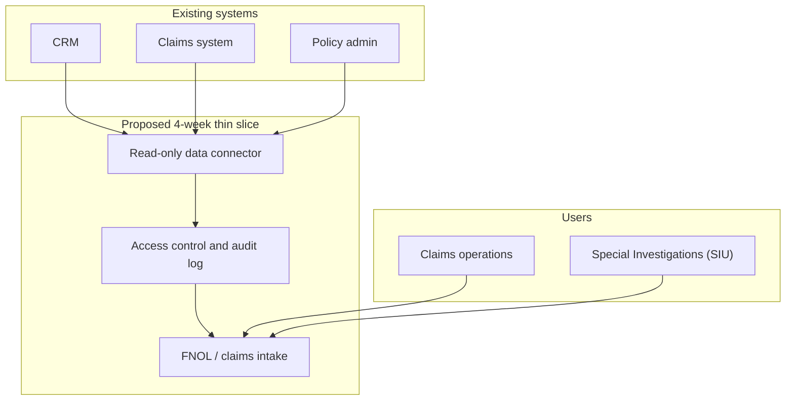

# 4-Week Statement of Work: AI Scoping Engagement — Northbridge P&C (sample)

**Generated:** 2026-11-24  
**Industry:** Insurance (P&C)  
**Data sensitivity:** Regulated  
**Size / footprint:** mid-size organization  
**Existing systems:** CRM, Claims system, Policy admin  
**Team context:** Mid-size carrier IT and claims operations

> This document was generated by the Automated Architecture Scoper, a portfolio demo. It is a starting point for a human-led discovery conversation — not a production architecture, a security assessment, or a legally binding statement of work. Every section should be reviewed with the customer before it is used in a real engagement.

## 1. Problem summary

Northbridge P&C (sample) is a mid-size insurance organization (mid-size organization) asking for AI help with FNOL / claims intake and Fraud triage for SIU in Claims operations and Special Investigations (SIU). Those workflows run on CRM, Claims system, and Policy admin and involve Financial / claims amounts and PII (personally identifiable information). That is a Regulated engagement: policyholder PII, financials, and any fraud-scoring output have to be explainable and carefully controlled.

The business problem underneath the ask is cycle time and manual review. FNOL intake is repetitive, and SIU triage is slow because analysts hunt for signals by hand. A four-week scoping engagement will map the intake and referral path, design a thin slice that assists — not auto-decides — claims and SIU staff, and leave the carrier with a pilot plan, KPIs, and a clear stance on model-risk and fairness questions. This is not a book of business go-live, and it is not an automated decline engine.

### Original customer ask

> We're a mid-size property and casualty insurer. We want AI to help with claims intake (FNOL) and to flag potentially fraudulent claims for our SIU team. Cycle time on first notice of loss is too long, adjusters spend hours on repetitive intake, and fraud review is mostly manual. We have a claims system and a policy admin platform, and we hold a lot of policyholder PII and financial data.

## 2. Assumptions

- A named business owner and a technical counterpart will be available for workshops in each of the four weeks.
- The engagement can start with read-only access or a safely extracted, minimized dataset from CRM, Claims system, and Policy admin — not live write access.
- The first pilot will be limited to a small number of users and sites rather than all of the customer footprint (site count to be confirmed) at once.
- Success metrics listed in this SOW are proposed starting points; baselines will be confirmed with the customer in week 1.
- This plan assumes English-language workflows and a US regulatory context unless discovery says otherwise.
- Fraud or SIU scoring, if shown at all, is a triage aid for human investigators — not an automatic denial or cancellation.
- A claims operations lead and, if fraud is in scope, an SIU contact will join discovery and the week-3 review.
- A historical claims extract (or a realistic synthetic set) can be provided with direct identifiers minimized.

## 3. Scope

### In scope

- Discovery with Claims operations and Special Investigations (SIU) and a current-state map of FNOL / claims intake and, if in scope, SIU referral through CRM, Claims system, and Policy admin.
- A target architecture for FNOL / claims intake and Fraud triage for SIU with read-only integration, access control, and an audit trail of recommendations.
- A STRIDE-style threat model covering PII, financial data, prompt injection against claims data, and misuse of fraud flags.
- A thin-slice prototype on historical or synthetic claims that illustrates intake structuring and/or SIU triage support.
- A pilot recommendation for one claims pod or line of business, with cycle-time and quality KPIs and model-risk notes.

### Out of scope

- A full production rollout across every site or department.
- Replacing or re-platforming core systems of record.
- Training a foundation model from scratch, or fine-tuning on the customer's full historical data warehouse.
- 24/7 production support, an SLA, or a multi-year transformation program.
- A formal legal review, penetration test, or certified compliance audit (the threat model here is a starting discussion, not an assessment).
- Any write-back that changes production records in week 1–3; write-back, if considered at all, is a week-4 recommendation only.
- Automated claim denial, settlement, or policy action without a human decision-maker.
- A production fraud model replacement, credit-style scoring rollout, or a formal model-risk validation opinion.
- Changes to policy wording, rating, or underwriting guidelines.

## 4. Four-week plan

### Week 1: Discovery and current-state mapping

**Goals**

- Pin the ask to concrete FNOL steps and, if requested, the SIU referral path.
- Inventory CRM, Claims system, and Policy admin and the claims data that would feed a thin slice.

**Activities**

- Kickoff with claims operations, intake leadership, SIU (if in scope), and IT.
- Sit with adjusters / intake specialists and walk live or recent FNOL files.
- Document handoffs, downstream systems, and where work today sits in email or spreadsheets.
- Agree which lines of business are in the slice and which claim types are excluded (e.g. litigated, SIU already open, catastrophe surge).
- Capture current cycle-time and quality metrics, however imperfect.

**Deliverables**

- Current-state map of FNOL / claims intake and Fraud triage for SIU.
- System and data inventory, including sensitive financial and PII fields.
- Confirmed prototype scope and exclusions.

### Week 2: Architecture, explainability, and threat model

**Goals**

- Design an architecture that assists intake and triage without becoming a silent decision engine.
- Write down how fraud signals would be explained and audited.

**Activities**

- Draft architecture: policy admin and claims read-only paths, minimization, access control, audit log, assistant / triage queue.
- Define output style: structured FNOL drafts, missing-info checklists, and (if in scope) a ranked 'review suggested' flag with reasons — not a fraud score presented as fact.
- STRIDE-style threat model with IT security and a claims quality or compliance contact.
- Choose the week-3 dataset and the identifier minimization approach.

**Deliverables**

- Target architecture diagram and narrative.
- Data-handling and explainability note.
- STRIDE threat model for the four-week slice.

### Week 3: Thin-slice prototype

**Goals**

- Show one working slice of FNOL / claims intake and Fraud triage for SIU that an intake specialist or SIU analyst can react to.
- Test whether the explanations are actually useful, not just technically present.

**Activities**

- Build a narrow prototype on the agreed extract: FNOL structuring and/or a 'please review' queue with human-readable reasons.
- Review with intake and SIU users. Score a small set of historical claims: would this have helped, and would it have been unfair or noisy?
- Record false positives / false negatives qualitatively — this is not a model validation, but we should not demo a clearly noisy flag as if it were ready.
- No write-back to the claims system.

**Deliverables**

- Working prototype (demo-quality) and a demo script for claims and SIU leaders.
- Qualitative error notes and user feedback.
- Updated architecture if needed.

### Week 4: Pilot plan, KPIs, and handoff

**Goals**

- Propose a pilot in one claims pod or line of business, with human decision rights unchanged.
- Leave a clear list of model-risk, fairness, and regulatory follow-ups.

**Activities**

- Draft the pilot: users, volume, duration, escalation to SIU, and what is explicitly not automated.
- Lock KPIs (cycle time, rework, referral quality) and how baselines come from CRM, Claims system, and Policy admin.
- Write residual risks and a go/no-go checklist, including any need for a formal model-risk review before wider use.
- Handoff readout with claims, SIU, IT, and compliance as available.

**Deliverables**

- Pilot plan with staffing, KPIs, and human-in-the-loop rules.
- Go/no-go checklist and residual risk register.
- Final architecture, threat model, and readout.

## 5. Proposed architecture

The proposed slice sits beside CRM, Claims system, and Policy admin; it does not replace the claims or policy admin platforms and it does not issue claim decisions. A read-only, minimized extract feeds an assistant used by Claims operations and Special Investigations (SIU) for FNOL / claims intake and Fraud triage for SIU. Access control and an audit log record what was suggested and why, which matters for both quality review and any later regulatory question. Data class is Regulated; relevant controls include Internal access control, Audit logging, GLBA, Model risk / explainability documentation for fraud flags, State insurance regulatory expectations, and State privacy laws (e.g. applicable US state privacy acts). Fraud-related output, if present, is a 'review suggested' aid with reasons, never an automatic adverse action. No write-back in weeks 1–3.

The diagram below is a Mermaid flowchart. GitHub, many Markdown previewers, and this app will render it. If your viewer does not, the text is still readable as a source list of systems and flows.

## 6. STRIDE-style threat model

This is a discussion starter for week 2, not a penetration test or a formal security assessment. STRIDE groups threats into Spoofing, Tampering, Repudiation, Information disclosure, Denial of service, and Elevation of privilege.

| STRIDE | Threat | Mitigation in this slice | Priority |
| --- | --- | --- | --- |
| Spoofing | An unauthorized user, vendor, or shared desk login queries policyholder files or SIU flags through the assistant. | Named accounts / SSO, role-based access (intake vs. adjuster vs. SIU), and session timeout. SIU flags are visible only to permitted roles. | High |
| Tampering | A user or injected prompt alters FNOL facts, reserve suggestions, or fraud flags if write-back is enabled. | Read-only in this engagement. Later write-back would be a draft requiring a licensed/authorized user confirm, with a full audit trail. | High |
| Repudiation | A customer, regulator, or internal quality team asks why a claim was referred to SIU or delayed, and the reasoning is not reconstructable. | Log the recommendation, the human-readable reasons, the data sources used, and the human's final action. | High |
| Information disclosure | Policyholder PII, financials, or SIU status leak to the wrong role, a model vendor, or another claim file's context. | Minimization and field-level exclusion; claim-level isolation; vendor terms / no training on carrier data by default; role-aware retrieval. | High |
| Denial of service | A volume spike (weather event, outage) makes the assistant unavailable just when intake load is highest. | The tool is an aid. Existing FNOL process remains usable without it. Document a fallback and do not put the assistant on the critical path in the pilot. | Medium |
| Elevation of privilege | An intake role sees SIU indicators, special investigations notes, or other claims they should not see. | Inherit claims-system permissions. Separate SIU views. Exclude open-investigation notes from the intake slice unless SIU is the user. | High |

### Compliance and control notes

- Internal access control
- Audit logging
- GLBA
- Model risk / explainability documentation for fraud flags
- State insurance regulatory expectations
- State privacy laws (e.g. applicable US state privacy acts)

_User-selected sensitivity: Regulated. Detected signals: financial / claims data, personally identifiable information._

## 7. Success metrics and KPIs

Baselines and targets are proposals. Week 1 confirms the real numbers, or honestly records that a baseline does not yet exist.

| Metric | Baseline | Target | How it will be measured |
| --- | --- | --- | --- |
| FNOL intake cycle time (first notice to a complete, usable claim file) | Confirm in week 1 from the claims system (median and 90th percentile, for the line of business in scope). | A 15–30% reduction in elapsed time on the intake steps the slice touches, without a rise in rework or missing-info send-backs. | Claims-system timestamps on a pre/post cohort, same line of business, excluding catastrophe spikes if possible. |
| Intake rework / missing-information rate | Share of new claims sent back or delayed for missing FNOL fields, from quality reports or a week-1 sample. | A lower missing-info rate, or at least no increase while cycle time improves. | Existing quality queues plus a structured sample of files. |
| SIU referral usefulness (if fraud triage is in the slice) | Current referral volume, and a qualitative sense of signal-to-noise from SIU (a formal precision/recall baseline may not exist — say so). | SIU analysts judge a majority of flagged 'review suggested' items as worth a look, with documented reasons. No automatic action on a flag. | SIU review of a labeled sample during the pilot; track 'useful / not useful / unfair or unexplained'. |
| User adoption and trust | Zero (new tool). | A majority of pilot intake staff or SIU analysts would keep the slice, and can explain what it does and does not decide. | Short weekly pulse plus a debrief with claims leadership. |

## 8. Risks

| Risk | Likelihood | Impact | Mitigation |
| --- | --- | --- | --- |
| System access or data extracts arrive late, shrinking the prototype window. | Medium | High | Request extract samples in week 1 day 1; have a synthetic/sample-data fallback so week 3 can still demo a thin slice. |
| Scope expands mid-engagement ('can it also do X?'). | High | Medium | Keep a visible parking lot. Anything new is logged and triaged in the week-4 recommendations, not added to the thin slice. |
| End users do not trust or adopt the assistant. | Medium | High | Sit with real users in week 1 and week 3. Design the prototype around one painful workflow, not a generic chatbot. |
| Compliance or legal review takes longer than the four-week window. | Medium | Medium | Engage compliance in week 2 with a written data-handling note. Use de-identified or synthetic data for the demo if production data cannot be cleared in time. |
| A fraud flag is treated as a decision, creating fairness, complaint, or regulatory exposure. | Medium | High | No automated adverse action. Language is 'review suggested' with reasons. Week-4 plan includes a model-risk follow-up before any wider use. |
| Historical claims data is too messy or biased for a useful week-3 demo. | Medium | Medium | Have a synthetic or heavily cleaned sample ready. Be honest in the readout about data quality and what that means for a later pilot. |

## 9. Staffing

| Role | Time over 4 weeks | Responsibilities |
| --- | --- | --- |
| Forward Deployed / Solutions Engineer (lead) | Full-time, 4 weeks | Discovery, architecture, prototype, threat model, and the final readout. |
| Claims operations sponsor | 2–3 hours per week | Scope, access to a claims pod, KPI definitions, and go/no-go. |
| SIU lead (if fraud triage is in scope) | 2–4 hours in weeks 1, 3, and 4 | Referral-path truth, review of flag language, and qualitative scoring of the sample. |
| Claims / policy IT owner | 4–6 hours per week | Extracts, permissions, integration constraints, and architecture review. |
| Compliance / model-risk contact (as available) | 2–4 hours in weeks 2–4 | Review of explainability, adverse-action boundaries, and residual follow-ups. |

## Appendix: Detected signals

This SOW was produced by a deterministic rules engine. The table below shows the phrases and fields that drove industry, data, system, and size choices. Optional form fields can override a detection; those overrides are listed after the table.

| Category | Label | Evidence | Weight |
| --- | --- | --- | --- |
| industry | Insurance (P&C) | "insurer", "Insurance", "claims", "FNOL", "first notice of loss", "policy" | 12 |
| data | Financial / claims amounts | "claims", "fraud", "loss", "financial data", "policy admin" | 5 |
| data | PII (personally identifiable information) | "PII", "policyholder" | 2 |
| system | CRM | "CRM" | 1 |
| system | Claims system | "claims system" | 1 |
| system | Policy admin | "policy admin" | 1 |
| department | Claims operations | "claims", "adjusters", "FNOL" | 3 |
| department | Special Investigations (SIU) | "SIU", "fraud" | 2 |
| use_case | FNOL / claims intake | "FNOL", "first notice of loss", "claims intake", "intake" | 4 |
| use_case | Fraud triage for SIU | "fraud", "SIU" | 2 |
| size | mid-size organization | "mid-size" | 1 |

**Overrides and user-provided fields**

- team size provided by the user

---

_Automated Architecture Scoper — portfolio demo. Review with a human before use._
