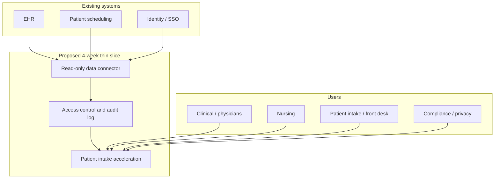

# 4-Week Statement of Work: AI Scoping Engagement — Cedar Ridge Health System (sample)

**Generated:** 2026-11-24  
**Industry:** Healthcare / hospital  
**Data sensitivity:** Regulated  
**Size / footprint:** 3 campuses; regional footprint; multi-site organization  
**Existing systems:** EHR, Patient scheduling, Identity / SSO  
**Team context:** Mid-size health system IT and clinical informatics

> This document was generated by the Automated Architecture Scoper, a portfolio demo. It is a starting point for a human-led discovery conversation — not a production architecture, a security assessment, or a legally binding statement of work. Every section should be reviewed with the customer before it is used in a real engagement.

## 1. Problem summary

Cedar Ridge Health System (sample) is a healthcare organization (3 campuses; regional footprint; multi-site organization) asking for AI help with Patient intake acceleration and Clinical documentation assistance in Clinical / physicians, Nursing, Patient intake / front desk, and Compliance / privacy. Those workflows live in EHR, Patient scheduling, and Identity / SSO and involve PHI (protected health information). That is a Regulated engagement: PHI and HIPAA obligations shape the architecture from day one, not as an afterthought.

The business problem underneath the ask is time and burnout — intake is slow, and clinicians are still finishing charts after hours — not 'add a chatbot to the EHR.' A four-week scoping engagement will map the real intake and documentation path, design a HIPAA-aware thin slice on de-identified or tightly controlled data, and leave clinical, IT, and compliance leaders with a pilot plan they can accept or reject. This is not a three-campus go-live.

### Original customer ask

> We're a regional hospital system with three campuses. We want AI to speed up patient intake and reduce the time clinicians spend on documentation after hours. Nurses and physicians are burned out on charting in the EHR, front-desk intake is slow, and our compliance team is strict about PHI and HIPAA. We use a major EHR and a separate patient-scheduling system.

## 2. Assumptions

- A named business owner and a technical counterpart will be available for workshops in each of the four weeks.
- The engagement can start with read-only access or a safely extracted, minimized dataset from EHR, Patient scheduling, and Identity / SSO — not live write access.
- The first pilot will be limited to a small number of users and sites rather than all of 3 sites at once.
- Success metrics listed in this SOW are proposed starting points; baselines will be confirmed with the customer in week 1.
- This plan assumes English-language workflows and a US regulatory context unless discovery says otherwise.
- A privacy / compliance counterpart will review the data-handling note in week 2.
- The week-3 prototype will use de-identified, synthetic, or otherwise approved data unless a documented exception is granted.
- No prototype output will be written into the legal medical record during this four-week engagement.

## 3. Scope

### In scope

- Discovery with Clinical / physicians, Nursing, Patient intake / front desk, and Compliance / privacy, HIM / clinical informatics, and IT security, and a current-state map of intake and documentation in EHR, Patient scheduling, and Identity / SSO.
- A HIPAA-aware target architecture for Patient intake acceleration and Clinical documentation assistance, including BAA considerations if a vendor processes PHI.
- A STRIDE-style threat model focused on PHI disclosure, auditability, and inappropriate access.
- A thin-slice prototype on de-identified or approved sample data that illustrates Patient intake acceleration and Clinical documentation assistance.
- A pilot recommendation for one clinic, unit, or campus, with quality and safety metrics and a compliance follow-up list.

### Out of scope

- A full production rollout across every site or department.
- Replacing or re-platforming core systems of record.
- Training a foundation model from scratch, or fine-tuning on the customer's full historical data warehouse.
- 24/7 production support, an SLA, or a multi-year transformation program.
- A formal legal review, penetration test, or certified compliance audit (the threat model here is a starting discussion, not an assessment).
- Any write-back that changes production records in week 1–3; write-back, if considered at all, is a week-4 recommendation only.
- Autonomous clinical decision-making, diagnosis, or treatment recommendations presented as medical advice.
- Any change to the legal medical record, coding, or billing without a separate, compliance-approved path.
- IRB submission or a formal research protocol (we will only flag whether one might be needed).

## 4. Four-week plan

### Week 1: Discovery and current-state mapping

**Goals**

- Pin the ask to specific intake and/or documentation steps that clinicians and front-desk staff actually feel.
- Inventory EHR, Patient scheduling, and Identity / SSO, identity, and where PHI moves today.

**Activities**

- Kickoff with a clinical sponsor, informatics, IT, and compliance / privacy.
- Shadow intake and after-hours documentation for a short session — watch the work, don't just interview about it.
- Collect the current metrics (door-to-provider, intake cycle time, after-hours EHR time if available).
- Agree what is in the thin slice and what must never appear in a demo (direct identifiers, minors, sensitive encounter types, etc.).

**Deliverables**

- Current-state workflow map for Patient intake acceleration and Clinical documentation assistance.
- PHI data-flow sketch and system inventory.
- Confirmed prototype scope, including an explicit list of excluded data classes.

### Week 2: HIPAA-aware architecture and threat model

**Goals**

- Design a target architecture that can sit beside EHR, Patient scheduling, and Identity / SSO with least-privilege access and a full audit trail.
- Get a first compliance reaction before any prototype is built on real data.

**Activities**

- Draft architecture: identity / SSO, EHR and scheduler read-only paths, de-identification, access control, audit log, assistant.
- Write a data-handling note covering BAAs, minimum necessary, retention, and where prompts and outputs live.
- Facilitate a STRIDE-style threat model with IT security and privacy.
- Decide the week-3 data source: synthetic, de-identified extract, or a tightly provisioned sandbox.

**Deliverables**

- Target architecture diagram and narrative.
- Data-handling and HIPAA considerations note.
- STRIDE threat model for the four-week slice.

### Week 3: Thin-slice prototype on approved data

**Goals**

- Show one working slice of Patient intake acceleration and Clinical documentation assistance that a front-desk user or clinician can react to.
- Keep PHI risk low enough that the demo can actually be shown.

**Activities**

- Build a narrow prototype (for example, intake questionnaire structuring, or a documentation draft the clinician must edit) on the approved dataset only.
- Review with a small group of end users and a compliance observer if available.
- Capture safety issues: hallucinated history, missed allergies, over-confident wording, or anything that looks like a diagnosis.
- Do not write back to the EHR.

**Deliverables**

- Working prototype (demo-quality) and a demo script for clinical and compliance leaders.
- Safety and usability notes, including any 'do not show this output to a patient' rules.
- Updated architecture if needed.

### Week 4: Pilot plan, quality metrics, and handoff

**Goals**

- Propose a limited pilot (one unit, clinic, or campus) with clear human-in-the-loop rules.
- Leave a go/no-go path that compliance and clinical leadership can stand behind.

**Activities**

- Draft pilot design: location, users, duration, supervision, and what happens when the tool is wrong.
- Lock quality and operations KPIs and how baselines will be measured.
- List residual HIPAA follow-ups, training, and whether a later IRB or formal security review is needed.
- Handoff readout with the sponsor, informatics, IT, and privacy.

**Deliverables**

- Pilot plan with staffing, KPIs, safety rails, and training.
- Go/no-go checklist and residual risk register.
- Final architecture, threat model, and readout.

## 5. Proposed architecture

The proposed slice does not replace EHR, Patient scheduling, and Identity / SSO and does not become the legal record. A read-only, least-privilege path — preferably through existing identity / SSO — feeds a minimized or de-identified dataset into an assistant used by Clinical / physicians, Nursing, Patient intake / front desk, and Compliance / privacy for Patient intake acceleration and Clinical documentation assistance. Access control and an audit log are mandatory, not optional, because the data class is Regulated. Relevant frameworks include Internal access control, Audit logging, HIPAA, and Business Associate Agreement (if a vendor handles PHI). Outputs are drafts or structured intake support that a human must review. No autonomous clinical action, and no write-back to the EHR, in this four-week engagement.

The diagram below is a Mermaid flowchart. GitHub, many Markdown previewers, and this app will render it. If your viewer does not, the text is still readable as a source list of systems and flows.

## 6. STRIDE-style threat model

This is a discussion starter for week 2, not a penetration test or a formal security assessment. STRIDE groups threats into Spoofing, Tampering, Repudiation, Information disclosure, Denial of service, and Elevation of privilege.

| STRIDE | Threat | Mitigation in this slice | Priority |
| --- | --- | --- | --- |
| Spoofing | A shared workstation or borrowed credentials lets the wrong person query or generate content about a patient. | SSO, no shared clinical logins for the assistant, automatic timeout, and the same break-glass rules the EHR already uses. | High |
| Tampering | A generated note is written into the legal medical record with incorrect history, meds, or allergies. | No write-back in this engagement. Any later draft-to-EHR path must require an attested clinician edit and leave an audit trail. | High |
| Repudiation | A clinician or staff member cannot show what the assistant proposed versus what was filed. | Immutable audit log of prompts, sources, and outputs, retained per the organization's health-record and HIPAA policies. | High |
| Information disclosure | PHI appears in prompts, model-provider logs, screenshots, or a demo deck, or is visible to staff who do not have a need to know. | Minimum necessary and de-identification for the prototype; no production PHI in slides; BAA if a vendor processes PHI; role-based access; ban of unsanctioned copy/paste into public tools. | High |
| Denial of service | Intake or documentation depends on a tool that is down during a busy clinic session. | The assistant is optional. Existing EHR and intake process remain the system of record and the fallback. | Medium |
| Elevation of privilege | A front-desk role uses the assistant to retrieve clinical data their EHR role does not allow. | The assistant inherits EHR/identity roles. Retrieval is role-aware. Sensitive encounter types can be excluded entirely from the slice. | High |

### Compliance and control notes

- Internal access control
- Audit logging
- HIPAA
- Business Associate Agreement (if a vendor handles PHI)

_User-selected sensitivity: Regulated. Detected signals: health data / PHI._

## 7. Success metrics and KPIs

Baselines and targets are proposals. Week 1 confirms the real numbers, or honestly records that a baseline does not yet exist.

| Metric | Baseline | Target | How it will be measured |
| --- | --- | --- | --- |
| Patient intake cycle time (arrival to complete intake) | Confirm in week 1 from scheduling / EHR timestamps or a time-motion sample. | A modest, agreed reduction on the steps the slice actually touches (set after the baseline is measured), without a rise in registration error rates. | EHR / scheduling timestamps plus a short observed sample on the pilot unit. |
| After-hours documentation time for participating clinicians | EHR audit or self-reported after-hours charting time, agreed in week 1 (this number is often incomplete — say so if it is). | A directionally lower after-hours burden on the documentation steps in scope, with no drop in note quality. | EHR audit logs where available, plus a weekly clinician pulse. |
| Documentation quality / safety flags | A small scored sample of notes or intake packets against a quality checklist (completeness, obvious inconsistencies). | No increase in quality defects; any hallucinated or unsafe draft is caught before it could reach a record. | Dual review of a weekly sample during the pilot; track 'assistant errors caught by the human'. |
| Clinician and staff adoption / trust | Zero (new tool). | A majority of pilot users would continue using the slice, and no safety-related stop-the-line event is left unaddressed. | Short pulse survey plus a live debrief with the clinical sponsor. |

## 8. Risks

| Risk | Likelihood | Impact | Mitigation |
| --- | --- | --- | --- |
| System access or data extracts arrive late, shrinking the prototype window. | Medium | High | Request extract samples in week 1 day 1; have a synthetic/sample-data fallback so week 3 can still demo a thin slice. |
| Scope expands mid-engagement ('can it also do X?'). | High | Medium | Keep a visible parking lot. Anything new is logged and triaged in the week-4 recommendations, not added to the thin slice. |
| End users do not trust or adopt the assistant. | Medium | High | Sit with real users in week 1 and week 3. Design the prototype around one painful workflow, not a generic chatbot. |
| Compliance or legal review takes longer than the four-week window. | Medium | Medium | Engage compliance in week 2 with a written data-handling note. Use de-identified or synthetic data for the demo if production data cannot be cleared in time. |
| Prototype outputs look like clinical advice or are trusted too much. | Medium | High | Label every output as a draft for human review. Ban diagnosis/treatment language in the slice. Review wording with the clinical sponsor in week 3. |
| PHI is accidentally used in a demo, log, or vendor tool. | Medium | High | Default to synthetic or de-identified data. Written data-handling rules. No screenshots of real charts. Compliance invited to the week-3 review. |

## 9. Staffing

| Role | Time over 4 weeks | Responsibilities |
| --- | --- | --- |
| Forward Deployed / Solutions Engineer (lead) | Full-time, 4 weeks | Discovery, HIPAA-aware architecture, prototype, threat model, and the final readout. |
| Clinical sponsor (CMIO, nursing lead, or clinic medical director) | 2–3 hours per week | Scope decisions, safety review, and go/no-go. |
| Clinical informatics / EHR analyst | 4–6 hours per week | Workflow truth, extract or sandbox access, and EHR constraints. |
| Privacy / compliance / information security | 3–5 hours in weeks 2–4 | Data-handling review, BAA questions, threat model, and pilot conditions. |
| End-user reviewers (intake staff and clinicians) | 2–4 hours across weeks 1 and 3 | Show the real work, test the thin slice, flag unsafe or unusable output. |

## Appendix: Detected signals

This SOW was produced by a deterministic rules engine. The table below shows the phrases and fields that drove industry, data, system, and size choices. Optional form fields can override a detection; those overrides are listed after the table.

| Category | Label | Evidence | Weight |
| --- | --- | --- | --- |
| industry | Healthcare / hospital | "hospital system", "Health System", "patient", "PHI", "HIPAA", "EHR" | 12 |
| data | PHI (protected health information) | "PHI", "HIPAA", "patient", "EHR", "charting" | 5 |
| system | EHR | "EHR" | 1 |
| system | Patient scheduling | "patient-scheduling", "patient scheduling" | 2 |
| system | Identity / SSO | "SSO", "identity" | 2 |
| department | Clinical / physicians | "clinician", "physician" | 2 |
| department | Nursing | "Nurses" | 1 |
| department | Patient intake / front desk | "patient intake", "front-desk" | 2 |
| department | Compliance / privacy | "compliance", "HIPAA" | 2 |
| use_case | Patient intake acceleration | "patient intake", "front-desk intake" | 2 |
| use_case | Clinical documentation assistance | "documentation", "charting", "after hours" | 3 |
| size | 3 campuses | "three campuses" | 1 |
| size | regional footprint | "regional" | 1 |

**Overrides and user-provided fields**

- team size provided by the user

---

_Automated Architecture Scoper — portfolio demo. Review with a human before use._
